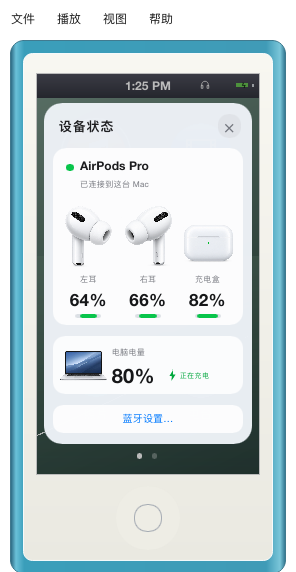

# Desktop devices and battery

Click the battery at the right of the nano status bar, or choose **View → Device Status…**. The desktop panel shows the computer's battery percentage and charging/power state, the macOS default audio output, and available left/right/case battery levels for that Bluetooth output. A headphone indicator appears in the status bar while headphones or Bluetooth audio are selected. Unknown values display a dash or “Battery unavailable”; they never default to full. Screen Mode and Device Mode share the same data and panel. iOS is unchanged.

The panel implements the approved concept: a large AirPods card with separate left/right/case illustrations and battery bars, a compact secondary computer-battery card, and a Bluetooth Settings button. It follows the quiet backgrounds and grouping in Apple's [macOS AirPods battery panel](https://support.apple.com/en-us/119912) and [AirPods connection card](https://support.apple.com/it-it/100494). The decorative, transparent device renders were made with the built-in image generator; [asset provenance and final prompts](../assets/images/desktop-devices/README.md) are stored with the PNGs. All percentages, bars, labels and connection state remain live Slint elements. This surface uses translucency and a shadow; it does not use AppKit's Liquid Glass material. The existing iPod shell is preserved.

The outer panel uses a 20-unit rounded, translucent surface. A rendered corner check verifies that the backdrop remains visible at the rounded corners in both desktop modes; the previous gradient-filled surface failed this check in the software renderer. Cards and the settings button have matching rounded edges.

## Native data and playback

- Public IOKit power-source APIs read only the internal computer battery. CoreAudio identifies the default output by UID, transport and name. These reads run on a separate worker every two seconds; CoreAudio route notifications trigger an earlier refresh.
- A separate worker reads `system_profiler SPBluetoothDataType -json` at most once every 30 seconds for the current Bluetooth output, or after its identity changes. Only connected devices whose Bluetooth address matches the CoreAudio UID contribute battery readings. It does not connect/pair devices, open a microphone or use private Bluetooth selectors. The probe has a five-second deadline and a bounded response. macOS can omit individual values or return cached values, particularly for a closed case.
- Headphone/Bluetooth output changing to speakers pauses the current music, podcast or video, including a loading source. This conservative policy also pauses a manual switch from headphones to speakers. Selecting/reconnecting headphones never resumes playback automatically. The notification and controller polling add a small delay; this is not an audio-thread mute guarantee.
- Existing macOS MediaPlayer metadata and command registrations remain available while music/podcasts are paused. Play and Pause are idempotent, and Pause is accepted during Loading. Received media commands remain in the playback diagnostics log; the main panel contains only device information and settings.
- On other desktop operating systems native data remains unavailable; macOS APIs and subprocesses are not called. No Bluetooth connection preferences are changed by the app.

## AirPods resuming music on an iPhone

This symptom has been reported but has **not yet been reproduced end to end with the physical AirPods button on this build**. Native callback tests verify that the paused item retains its metadata, the Play command stays enabled and its copied handler still delivers Play. That does not establish which device Apple chooses for a real button press.

After starting this build, select the AirPods as the Mac's output and play/pause a track, then press the AirPods once. A new `macos_remote_command_received` record in `playback.jsonl` confirms that macOS delivered a command to this app. If no record appears while the iPhone starts playing, inspect the Mac's output and the AirPods connection settings before attributing that event to the Rust transport.

Desktop playback diagnostics also record native media-state changes, received commands and the output-change pause in the configuration directory's `playback.jsonl`. Disk writes run on the existing bounded diagnostics worker; logs rotate at 256 KiB with one previous file. These new records contain control/state names, not song titles, Bluetooth addresses, serial numbers, credentials or lyrics.

Apple documents [automatic switching and how to disable it](https://support.apple.com/en-us/104988). To keep using the Mac, choose the AirPods from macOS Control Center → Sound. If unwanted switching persists, the user can set **Connect to This iPhone/Mac → When Last Connected to This Device** in the relevant AirPods settings. “Bluetooth Settings…” opens the Mac's settings only when clicked; the app cannot force a button already routed to the phone back to the Mac.

## Verification

Focused native/controller tests cover valid and missing capacities, address matching, disconnected-device rejection, native snapshot/watch lifetime, retained paused metadata/Play registration, and music/podcast/video output-change pause behavior. Software-renderer tests exercise battery-level changes, both desktop modes, English/Chinese/Japanese layouts, settings-button dispatch, opening from the battery, Escape, close-button and backdrop dismissal. Rendered cases also cover missing/zero capacities, long names, speakers and single-battery accessories. All four decorative PNGs have genuine alpha transparency; their display crops retain the products and soft shadows. On 2026-10-22, read-only probes on the development Mac identified the selected AirPods by address and retrieved computer, left, right and case percentages. Physical earbud presses, cross-device arbitration and audible route transitions still require manual acceptance.
