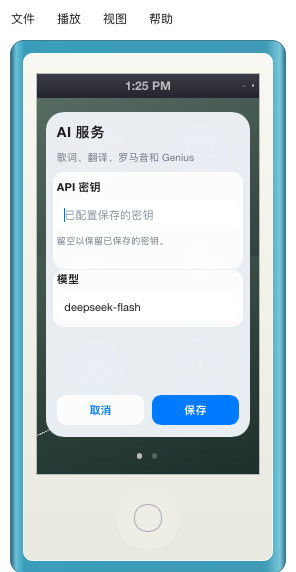
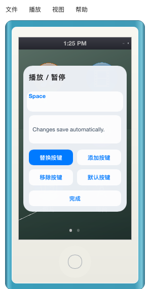
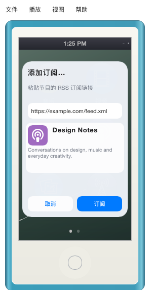
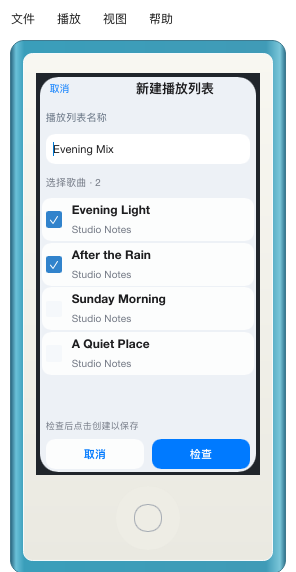
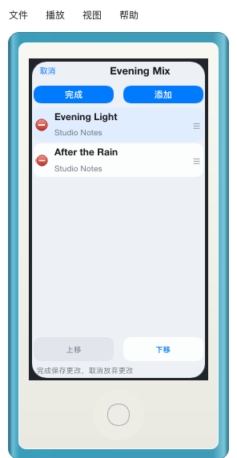
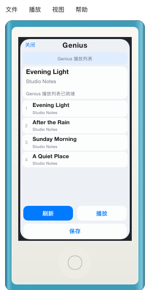
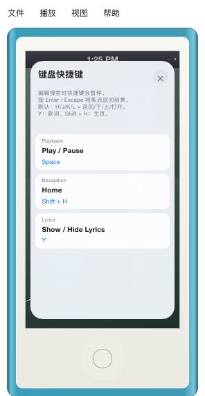
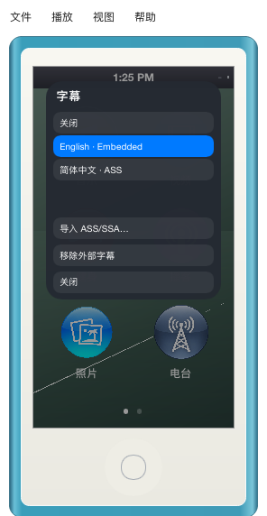
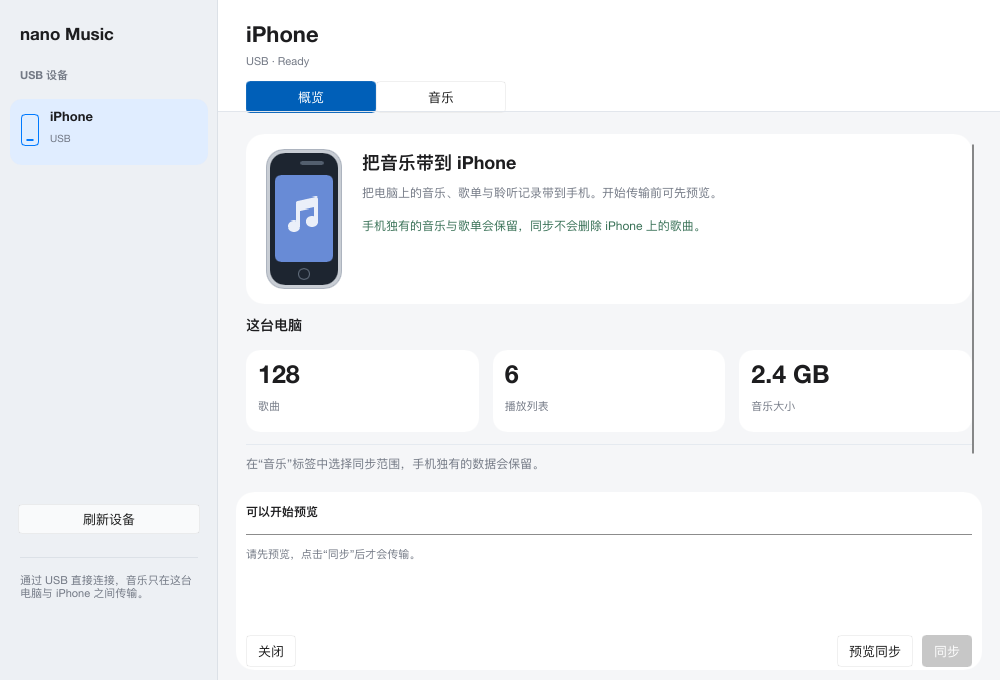

# Added desktop interfaces

The desktop tools added beyond the original iPod screens now follow the rounded device-status panel: quiet pale surfaces, white grouped cards, blue primary actions and native sans-serif text. This is a Slint visual treatment, not an AppKit material. The iPod shell, Home, library and playback screens retain their existing appearance. Shared AI, Genius and playlist components select the new styling only outside touch mode; iPhone screens keep their existing skin and touch targets.

| Interface | Changes |
| --- | --- |
| AI Services | Rounded panel, grouped key/model cards, consistent input and Save/Cancel controls. Password masking and saved-key behavior remain in place. |
| Shortcut editor and reference | Grouped controls, readable key labels and matching rounded surfaces. The reference stays within the player display in both desktop modes. |
| Podcast subscription | Rounded RSS input and preview card with blue Preview/Subscribe actions. |
| Playlist creation and editing | Rounded song rows, pale selection, consistent action buttons and a red Delete control. Row coordinates and drag capture retain the existing ordering behavior. |
| Genius | Rounded song/seed cards and shared actions. An opaque full-page backing prevents playing-title changes from bleeding through the frozen preview. |
| Subtitle selection | Dark rounded panel, translucent rows and blue selection. |
| iPhone sync on the computer | Pale sidebar, white device/statistics/status cards and matching type. Standard buttons, radio controls, checkboxes and progress remain keyboard accessible. |

## Actual rendered previews

These captures use offline fixture values and the real Slint components. They contain no API key, personal library data or actual transfer.

| AI Services | Shortcut editor | Podcast subscription |
| --- | --- | --- |
|  |  |  |

| Playlist selection | Saved playlist editing | Genius |
| --- | --- | --- |
|  |  |  |

| Shortcut reference | Subtitle selection |
| --- | --- |
|  |  |

## Reproduce and verify

Run `cargo run --example desktop_tools_preview` to export 72 PNGs into `target/desktop-tools-preview` (or pass an output directory). The exporter renders English, Chinese and Japanese in Device and Screen modes, plus the sync window at its normal/minimum sizes, on the Music tab and during a simulated transfer. It creates no controller, plays no audio, contacts no provider and starts no synchronization job.

Existing UI/navigation, podcast, settings, Genius and playlist tests exercise keyboard focus, password masking, busy states, draft cancellation, save/retry and pointer drag/remove flows. The sync adapter tests use a subprocess fixture to verify preview, cancellation, receipt and conflict handling. `cargo check --features mobile --lib` also checks the retained shared touch-mode branches.
