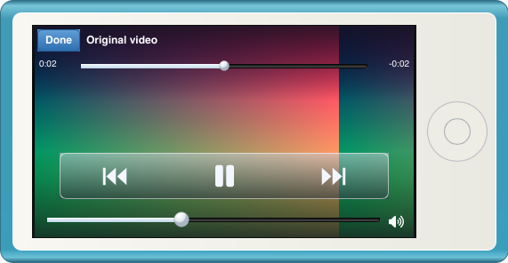

# Local video implementation

## Current milestone

Videos is integrated into the app's Home navigation, File menu, reducer and
controller. The `src/video` backend imports local video metadata, stores a separate
`videos.json` library, and plays through dynamically loaded libmpv. `ui/video.slint`
provides the playback view. Music tables, playlist schema and music queue indices
are independent of the video library.

The interface follows chapter 5, pages 27–28 of the supplied iPod nano seventh
generation manual (`/Users/huanzichen/Downloads/Study/References/46034.pdf`): select
from Videos; tap the image to show/hide Done, position and transport controls.
Desktop volume is also visible. Frames fit the available display without cropping.
Landscape playback rotates the whole device, as described below.
ASS/SSA sidecars, embedded subtitle tracks, selection/Off and per-video preferences
are supported; see [subtitle implementation](SUBTITLES_IMPLEMENTATION_PLAN.md).
During playback, tap the image to reveal the controls, then choose **Subtitles →
Import ASS/SSA…** to attach or replace a subtitle file for that video. The Subtitles
button is at the bottom left in portrait/landscape and Device/Screen Mode. Desktop
users can also choose **File → Import ASS/SSA…** while the video screen is open.
Chapter selection, rentals and video playlists are outside this milestone.

## Watch progress

Video positions are stored by canonical imported path in `video-progress.json`,
independently of `videos.json`, so importing or refreshing metadata preserves watch
history. Opening a partially watched video resumes its saved position, including
after restarting the app. Completed videos replay from the beginning. Seeking
back to zero replaces the saved position; failed/loading sessions do not erase it.
Positions are saved every five seconds during playback and on pause, seek, media
handoff, settings save and normal shutdown. Abrupt process termination can lose up
to the latest five seconds. Writes atomically replace the progress file; failures
report an error and retain dirty history for retry.

## Missing files

The library retains imported rows until playback is requested. Clicking a video
checks its original path on the playback worker before creating a libmpv session.
A moved/deleted file (or a path replaced by a directory) is removed from
`videos.json` and the visible list. The library worker rechecks the path before
removal, serializes removals with imports, and reports persistence failures.
Permission and other I/O errors preserve the row. Unclicked rows are not checked
or removed; no per-video filesystem watchers or persistent file handles are added.
Existing thumbnail extraction behavior is unchanged.

Removing a row retains its watch progress and subtitle preferences. Reimporting a
video at the same path can resume its previous position. Moving a file to another
path does not automatically transfer its history or locate its new location.

## Whole-device landscape orientation

The user requested that landscape playback turn the entire nano 90 degrees.
`Video::is_landscape()` uses display aspect after sample-aspect and rotation metadata
are applied. Portrait and square videos retain the upright body. The orientation
stays landscape while pausing or reaching EOF on the video screen, and returns to
portrait when leaving that screen.

`ui/video-device.slint` supplies the complete device frame. Landscape places the
physical Home button on the right, rotates the vector shell 90 degrees
counterclockwise, and gives the LCD a **432×240** logical viewport. Video and controls
relayout upright inside that viewport. Device Mode's whole content rectangle swaps
from **296×571.82** to **571.82×296**; Screen Mode swaps from **240×432** to **432×240**.
The shape remains proportional at every zoom. `ui/video-shell.svg` uses exactly the
existing shell's vector geometry under a quarter-turn, including its gradients.
It supports software rendering without relying on unsupported Slint transforms.

The app binds the child's coordinates to the frame's LCD bounds and scale. The
controller swaps native content dimensions and Slint minimum/maximum bounds,
keeping menus outside the device. `orientation::window_base` maintains aspect;
`orientation::saved_size` persists canonical upright dimensions even when closing
during landscape playback. Done/Back and Home restore portrait at the current zoom.

The landscape overlay follows the manual's compact arrangement: Done, elapsed,
seek and remaining share one top row. The transport panel is centered at 56% of
LCD width. A compact desktop volume/mute row sits below it; tapping the video
toggles the overlay. Portrait playback retains the title and two-row top controls.
Opening a portrait-only playlist, Genius, shortcut editor or help dialog from
landscape uses Done/Back semantics first, pausing video and retaining the Videos
list selection and zoom. Existing music dialog behavior is unchanged.

Integrated software-rendered app previews and native decoded-frame previews were
visually inspected. The normal running app was not restarted for these tests;
combined app packaging and native delivery are handled by the primary chat.

## Runtime dependencies and formats

On macOS, install `brew install mpv` (includes FFmpeg/ffprobe). The development
machine was exercised with Homebrew mpv 0.41.0 and FFmpeg 9.0.2 on Apple Silicon.
No native libraries are linked into the Rust binary at build time. `libloading`
0.8.9 is the only additional Rust dependency.

- Playback loads libmpv client ABI **2** (mpv 0.35 or newer), tries Apple Silicon
  and Intel Homebrew locations, then platform library names. `NANO_MPV_LIBRARY`
  supplies an additional library candidate. Missing/incompatible libraries return
  a playback error, without preventing music or app startup.
- Import runs ffprobe, preferring `NANO_FFPROBE`, then Homebrew paths, then PATH.
  Missing ffprobe produces import errors. Probe execution is limited to 15 seconds
  per file, with bounded retained output. Sources must be ordinary local files.
- The importer accepts **MP4, M4V, MOV, MKV, WebM, AVI** extensions (case insensitive),
  then requires an actual video stream with finite duration and nonzero dimensions.
  An attached cover image does not qualify. Metadata probing does not guarantee
  that the installed mpv build can decode a particular codec.
- Verified generated clips (320×180, 24 fps): **MP4/M4V/MKV with H.264 + AAC**,
  **MOV with H.264 + PCM S16LE**, **WebM with VP9 + Opus**, **AVI with MPEG-4 Part 2
  + MP3**, and **silent MP4/H.264**. Other codec/container combinations depend on
  the installed FFmpeg/mpv build and remain unverified. Encrypted/DRM files are unsupported.
- Decoder output is SDR 8-bit RGB. Hardware decoding, HDR fidelity and GPU texture
  import are not implemented. Windows/Linux library candidates are provided but
  native compilation, audio output and packaging have not been verified there.

libmpv's software renderer first appeared in mpv 0.33, but this wrapper deliberately
requires ABI 2 and does not attempt compatibility with old ABI 1 installations.
The Homebrew runtime is installed separately. It is not copied into the app bundle.
Redistributing libmpv/FFmpeg requires reviewing the exact build's licenses and
dependencies; mpv's default build is GPL, with an optional LGPL build configuration.

## Worker and library design

`Engine` owns one worker, which owns every mpv handle and callback lifetime. A load
destroys the previous session before creating another, even for the same path.
Every transport command, progress snapshot, frame, completion and error carries a
monotonically increasing generation supplied by the reducer. Stale transport
commands are ignored. Native events cannot cross session boundaries. EOF replay
and seek open a fresh generation; seeking after EOF starts paused at the requested
position. Native errors destroy the session, clear the latest frame and publish a
matching Error snapshot, preventing stale Playing progress from overriding errors.

The worker uses asynchronous mpv commands and property observations after render
context creation, following the renderer's threading restrictions. mpv owns
demuxing, decoding, audio output, synchronization, seek and pause. The callback
only sets an atomic update flag. Rendering and copying happen on the worker.
Software targets have 64-byte aligned pointers/strides and a longest dimension of
640 pixels; display aspect accounts for sample aspect ratio and rotation metadata.
The RGB0 byte is explicitly converted to opaque alpha before reaching Slint.

`take_frame` and `take_progress` consume a single latest-value slot each. A slow UI
replaces old frames instead of accumulating a decode backlog. The controller
converts owned RGBA bytes to `slint::SharedPixelBuffer<Rgba8Pixel>` / `Image` on the UI
thread and rejects generations that are no longer current. UI resizing uses Slint
`image-fit: contain`, preserving aspect. A separate 16 ms timer consumes frames;
navigation and progress use the existing 50 ms poll. Native shutdown frees the render context before mpv,
then joins the worker without holding the frame mutex.

Library import runs on a separate worker. It recursively scans supported
extensions, canonicalizes paths, merges duplicates by path, sorts titles, and
atomically replaces `videos.json`. Probe failures retain existing entries and
report per-file errors. A corrupt existing library is preserved and reported,
rather than overwritten. Original media is never modified or copied.

## Application integration

Home → Videos provides Import Videos and local video rows. File → Import Videos
opens a file picker on a worker; Command/Ctrl+O imports videos when in the video
list or player. Cancellation clears busy state, and source titles remain literal
across languages. Notices and action labels use the existing translation catalog.

The reducer owns the current video index, generation, progress/status and overlay.
Space, volume/mute, seek, previous/next and Now Playing route to the current media
owner. Done/Back pauses and returns to Videos; Home retains active media controls.
Choosing a music row explicitly switches back to music and its existing queue.

Ownership transitions are acknowledged: music destroys its sink/output stream
before video Load; video destroys the native session before music Load. Only the
latest matching handoff acknowledgement starts the pending source. Pause, volume
and seeking during a handoff use current reducer state when the load begins.
Music completion/progress is ignored while video owns the output; video frames,
completion and errors are accepted only for the active generation.

## Verification

`src/video/tests.rs` contains three ignored native tests, so default test runs do
not require libmpv/FFmpeg. Run them with `cargo test --lib video:: -- --include-ignored`.
They exercise generated original media, import/reload/deduplication, damaged files,
RGB frames/alpha, pause, paused seek, volume, stale generations, reopening the same
file, EOF replay/seek, stop, missing-source Error snapshots, a real non-null audio
driver, the codec/container matrix and silent video. Metadata tests cover anamorphic
aspect, rotation and attached-picture rejection.

`tests/video.rs` verifies orientation/navigation, separate music queue/position,
transport routing, EOF generations, stable video indices and translations.
`tests/video_ui.rs` renders the actual app and checks Device/Screen Mode dimensions,
zoom, persisted upright size, compact landscape seeking/volume/transport hit areas,
Done and Home, portrait sources, and usable portrait dialogs after landscape.
Its ignored native test imports a generated MP4, receives actual decoded frames,
checks rotation, Back/pause, EOF replay and acknowledged return to generated music.
Run it with `cargo test --test video_ui -- --ignored`.

Full application validation passes: formatting, `cargo check --all-targets`,
117 default tests (seven explicitly ignored native/manual profiles), strict Clippy
and whitespace checks. All four explicit native video checks also pass, including
the integrated decoded-frame/music-handoff test after the compact-overlay/dialog
refinement. Generated previews are saved
under the system temporary directory's `nano-qa` folder. No user media is imported
or changed during verification. Native normal-app QA remains with the primary chat.

## Primary references

- [libmpv C client ABI](https://github.com/mpv-player/mpv/blob/v0.41.0/include/mpv/client.h)
- [Render ABI, software format/alignment and threading rules](https://github.com/mpv-player/mpv/blob/v0.41.0/include/mpv/render.h)
- [Official software-rendering example](https://github.com/mpv-player/mpv-examples/blob/master/libmpv/sdl/main_sw.c)
- [mpv client API changes](https://github.com/mpv-player/mpv/blob/v0.41.0/DOCS/client-api-changes.rst)
- [mpv commands/properties](https://mpv.io/manual/stable/)
- [FFprobe machine-readable metadata](https://ffmpeg.org/ffprobe.html)
- [Homebrew mpv runtime formula](https://formulae.brew.sh/formula/mpv)
- [mpv licensing/build exceptions](https://github.com/mpv-player/mpv/blob/v0.41.0/Copyright)
